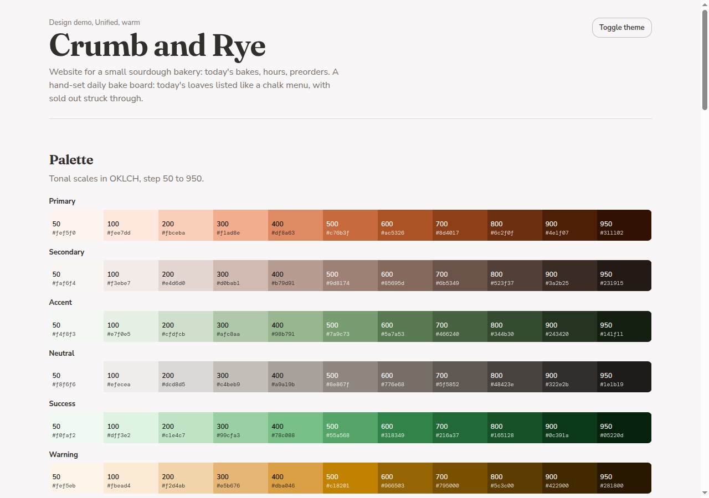
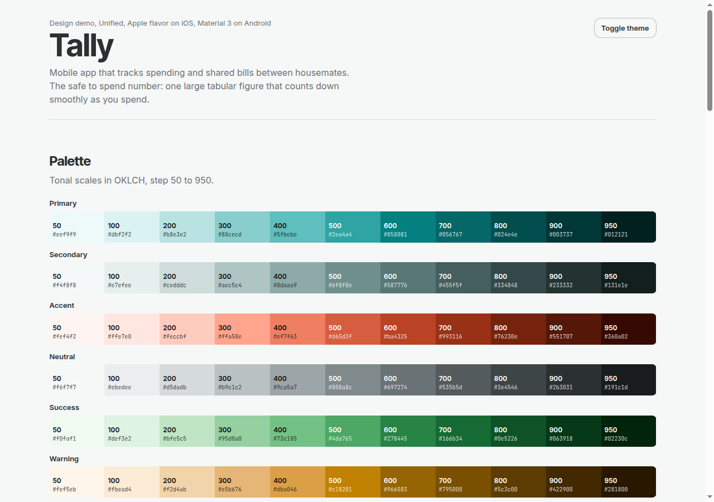
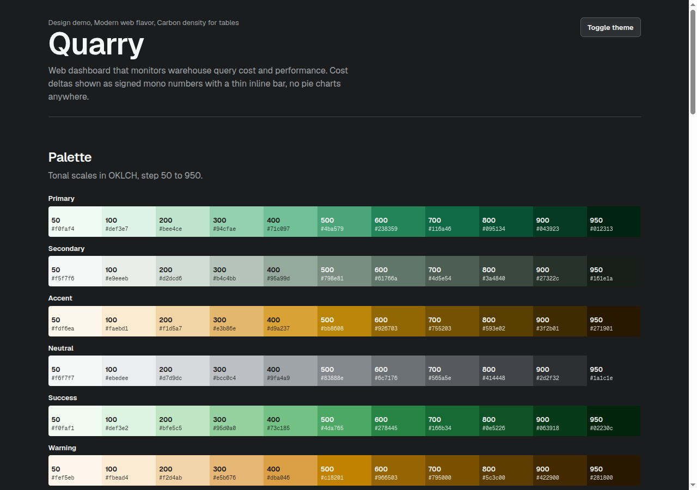

# designed

[](https://www.npmjs.com/package/designed-skill) [](https://github.com/n1th1n-19/designed/actions/workflows/ci.yml) [](LICENSE)

An agent skill for UI/UX. It plans and builds interfaces for any platform with one design system drawn from Apple HIG, Material 3, Samsung One UI, Fluent 2, IBM Carbon, Shopify Polaris, Atlassian, and the Linear, Vercel and Stripe style.

It works with Claude Code, Codex, Cursor, Gemini CLI and any agent that reads Agent Skills.

| Bakery site | Finance app | Analytics dashboard |
|---|---|---|
|  |  |  |

## What it does

1. **Understands the product first.** It reads your repo, asks what it cannot find out, looks at competitors, and writes a short brief. No colors or layouts before that.
2. **Picks a mode.** One unified system by default, or a flavor when the product needs it: Apple, Material 3, One UI, Fluent 2, Carbon, Polaris and Atlassian, or Modern web.
3. **Builds a full brand kit.** Color scales in OKLCH with light and dark roles, a font pairing from free sources, a type scale, spacing, radii, elevation, motion, icons, imagery, logo direction, and voice. Contrast is checked by a script, not by eye.
4. **Offers a demo.** It asks if you want to see the design first, then builds a single HTML page with the palette, type, every component state and your key screens.
5. **Writes `designed.md`.** The project's design record, plus `tokens.json` for code. It adds a pointer to `CLAUDE.md` and `AGENTS.md` so every later session and every agent follows it.
6. **Builds and reviews.** Platform code from the tokens, a checklist, and a drift check that flags any color, font or spacing value that is not in the system.

It also covers motion: scroll scrubbed image sequences, parallax, scroll driven reveals, view transitions, shared elements, micro-interactions, Lottie and Rive, each with when to use it, code, and a reduced motion alternative.

Rules it holds to: discovery before design, nothing that looks machine generated, no emojis and no em dashes, and `designed.md` as the single source of truth.

## Install

Pick one.

```bash
# Any agent, via the Agent Skills CLI
npx skills add n1th1n-19/designed

# npm, bun, pnpm or yarn (installs for every agent it finds)
npx designed-skill
bunx designed-skill
pnpm dlx designed-skill
yarn dlx designed-skill

# One line, no Node needed
curl -fsSL https://raw.githubusercontent.com/n1th1n-19/designed/main/install.sh | bash
```

Claude Code plugin marketplace:

```
/plugin marketplace add n1th1n-19/designed
/plugin install designed@designed
```

Gemini CLI:

```bash
gemini extensions install https://github.com/n1th1n-19/designed
```

Installer options:

```
npx designed-skill --claude      only Claude Code (also --codex --cursor --gemini --agents)
npx designed-skill --project     into ./.claude/skills of the current folder
npx designed-skill --dir <path>  into <path>/designed
npx designed-skill update        refresh every existing install
npx designed-skill uninstall     remove it
```

Manual: copy `skills/designed` into your agent's skills folder.

## Use

```
/designed a booking site for a small climbing gym
/designed brand        brand kit and tokens only
/designed demo         rebuild the demo from designed.md
/designed sync         update designed.md and tokens.json after changes, check drift
/designed audit        turn an existing codebase into a draft designed.md
```

Once a project has `designed.md`, you do not need the command. Ask for any UI work and the agent reads it first.

## Scripts

Zero dependency Node 18+, in `skills/designed/scripts/`:

```bash
node palette.mjs --primary 45:0.13 --accent 140:0.07 --out tokens.json   # OKLCH scales, roles, contrast pairs
node contrast.mjs tokens.json                                            # WCAG check for every pair, both themes
node drift.mjs tokens.json src/                                          # off-token values in code
node drift.mjs --report src/                                             # inventory for audits
```

## Works with other skills

`designed` hands work to other skills at the right step when they are installed, such as `frontend-design` for aesthetic direction, `anatomy` and `hairline` for illustrations, `dataviz` for charts, Figma and Expo skills for their platforms, and `impeccable` for critique. If one is missing it asks whether you want to download it. Full list in [companions](skills/designed/references/companions.md).

## Examples

Each folder in [examples](examples) has a `designed.md`, `tokens.json` and `design-demo.html` made with the skill. Open the HTML files in a browser.

## Contributing

New flavors, presets and companions are welcome. See [CONTRIBUTING](CONTRIBUTING.md).

Directories: [skills.sh](https://skills.sh) lists it automatically from `npx skills add` installs. It is also on [npm](https://www.npmjs.com/package/designed-skill).

## Note on sources

The guidance is written from the public principles of each design system. It does not copy their documentation and does not include their fonts, icons or logos. Names of design systems belong to their owners and are used only to describe the style.

## License

MIT
